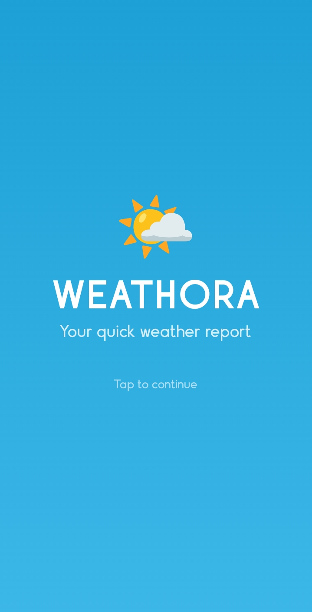
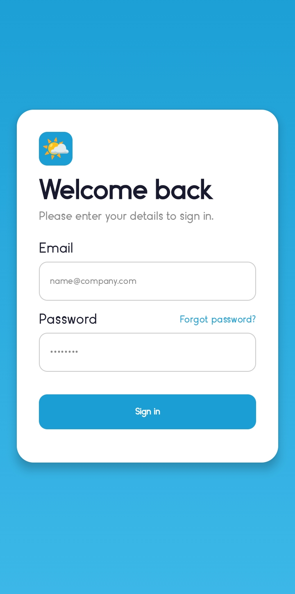
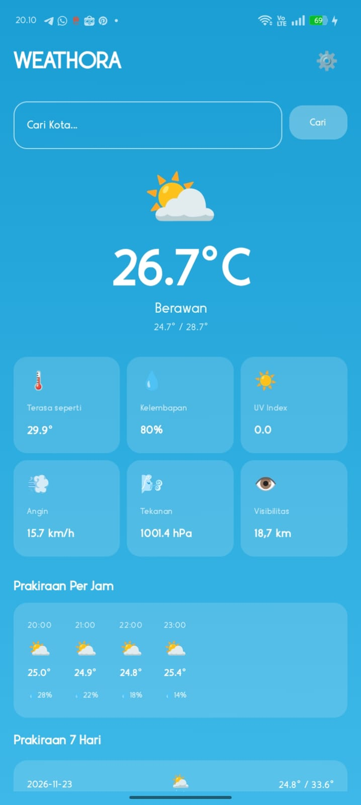
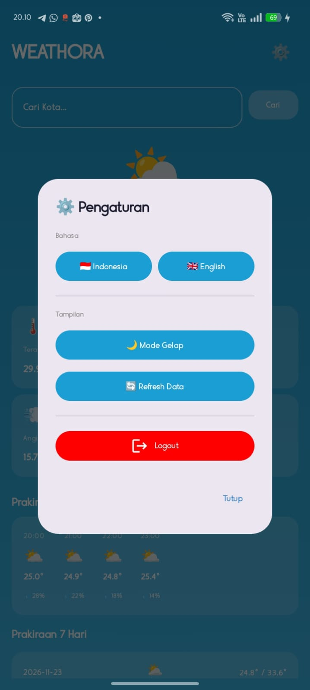
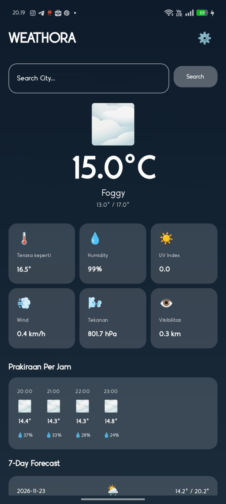
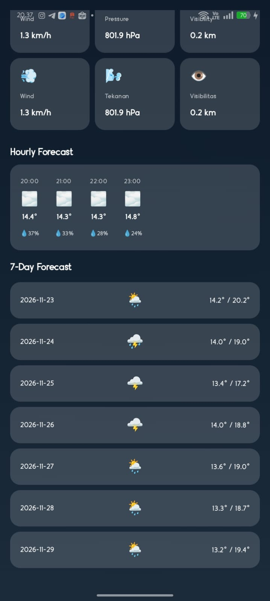
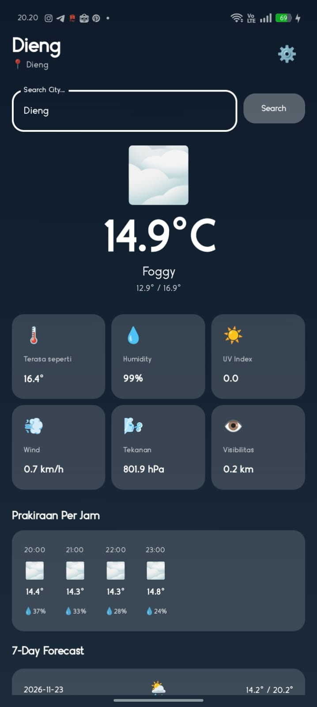
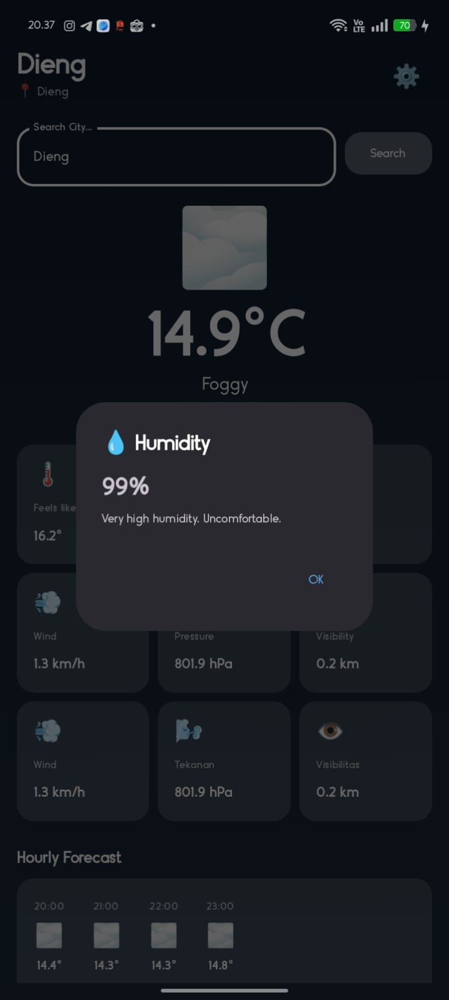

# WEATHORA - Weather Information App

WEATHORA adalah aplikasi informasi cuaca berbasis Android yang digunakan untuk
menampilkan data cuaca secara real-time dengan tampilan modern, elegan, dan mudah digunakan.

## Deskripsi Aplikasi

WEATHORA adalah aplikasi cuaca berbasis Android yang dibuat untuk mempermudah
pengguna dalam mendapatkan informasi cuaca terkini. Aplikasi ini memiliki fitur
seperti menampilkan suhu, kondisi cuaca, kelembapan, kecepatan angin, prakiraan
cuaca per jam, dan prakiraan 7 hari ke depan. Dengan tampilan yang modern dan
mudah digunakan, aplikasi ini cocok digunakan sebagai referensi cuaca sehari-hari.

## Fitur Utama

- Splash Screen dengan animasi
- Halaman Login
- Deteksi lokasi otomatis (GPS)
- Pencarian kota
- Menampilkan suhu saat ini
- Menampilkan kondisi cuaca
- Menampilkan kelembapan udara
- Menampilkan kecepatan angin
- Menampilkan UV Index
- Menampilkan tekanan udara
- Menampilkan visibilitas
- Prakiraan cuaca per jam
- Prakiraan cuaca 7 hari
- Tombol refresh data
- Mode Gelap (Dark Mode)
- Multi Bahasa (Indonesia & Inggris)
- Dialog detail informasi cuaca

## Teknologi Yang Digunakan

- Android Studio
- Kotlin
- Jetpack Compose
- Retrofit
- Gson
- ViewModel
- Open-Meteo API (Free, No API Key)
- Google Play Services Location

## Cara Menjalankan Project

1. Clone repository

```bash
git clone https://github.com/nurlanaaaaa3/Weathora.git
```

2. Buka project menggunakan Android Studio

3. Tunggu proses Gradle selesai

4. Jalankan aplikasi menggunakan Emulator atau HP Android

## Struktur Project

```
com.nurlana.wathora
├── model/          → Data class (WeatherResponse, CurrentWeather, dll)
├── network/        → Retrofit API Service & Instance
├── viewmodel/      → WeatherViewModel
└── ui/
    ├── screen/     → WeatherScreen, LoginScreen, SplashScreen
    └── theme/      → Color, Theme, Typography
```

## API Yang Digunakan

Aplikasi ini menggunakan **Open-Meteo API** yang gratis dan tidak memerlukan API Key.

- **Weather API**: `https://api.open-meteo.com/v1/forecast`
- **Geocoding API**: `https://geocoding-api.open-meteo.com/v1/search`

## 📸 Screenshots Aplikasi

### ☀️ Mode Terang (Light Mode — Bahasa Indonesia)

| Splash Screen  | Login       | Beranda       | Pengaturan        |
|----------------|-------------|---------------|-------------------|
|  |  |  |  |

### 🌙 Mode Gelap (Dark Mode — Bahasa Inggris)

| Beranda Dark                                             | Prakiraan Per Jam                                     | Pencarian                                             | Detail Info                                        |
|----------------------------------------------------------|-------------------------------------------------------|-------------------------------------------------------|----------------------------------------------------|
|  |  |  |  |

---

## Kelebihan Aplikasi

Kelebihan dari WEATHORA adalah tampilannya yang modern dengan background gradasi
biru yang menarik dan mudah digunakan sehingga pengguna dapat melihat informasi
cuaca dengan cepat dan praktis. Aplikasi ini mampu mendeteksi lokasi pengguna
secara otomatis menggunakan GPS, sehingga langsung menampilkan cuaca setempat
saat dibuka. Selain itu, aplikasi mendukung multi bahasa (Indonesia dan Inggris)
serta mode gelap untuk kenyamanan pengguna. Data cuaca yang ditampilkan lengkap
mulai dari suhu, kelembapan, angin, UV Index, tekanan udara, visibilitas,
prakiraan per jam, hingga prakiraan 7 hari ke depan.
